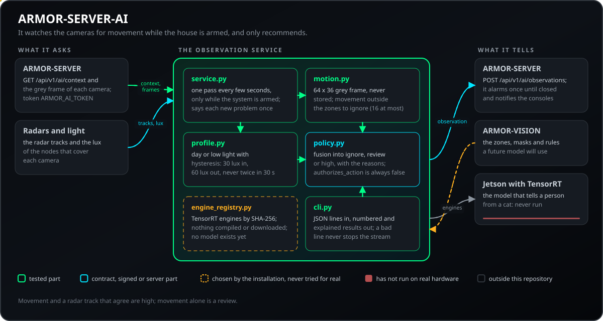
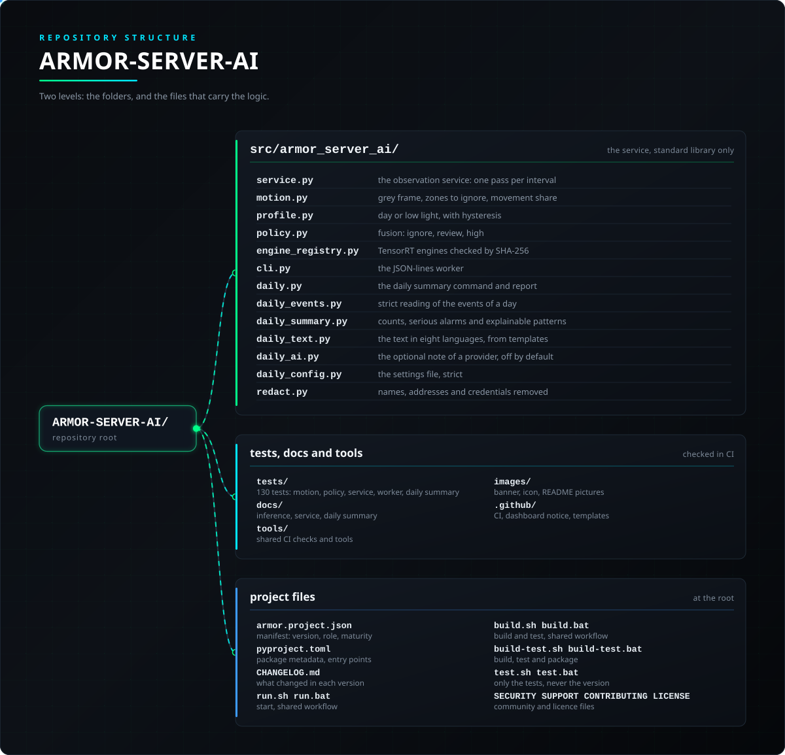

<p align="center">
  
</p>

# 👁️ ARMOR-SERVER-AI

<p align="center">
  <a href="README.md">🇺🇸 English</a> |
  <a href="README_spa.md">🇪🇸 Español</a> |
  <a href="README_fra.md">🇫🇷 Français</a> |
  <a href="README_ita.md">🇮🇹 Italiano</a> |
  <a href="README_deu.md">🇩🇪 Deutsch</a> |
  <a href="README_zho.md">🇨🇳 简体中文</a> |
  🇯🇵 <b>日本語</b> |
  <a href="README_por.md">🇵🇹 Português</a>
</p>

### 観察サービス：カメラ上の動きをレーダーと照らし合わせます。判断して説明するだけで、決して動作させません

<p align="center">
  
  
  
  
  
  
</p>

---

**正直さのチェック - 今日動いているもの:** 判断レイヤーと動き検出器は実在し、テストされています（80 件）。観察サービスは **CM5 テストベンチで動作**しており、システムの警戒中に実際の IP カメラの小さなグレーフレームを見て、レーダーと照らし合わせた動きを報告します。人と猫や枝の区別はできません。**検出モデルはまだなく**、Jetson、TensorRT、そこでデコードした RTSP ストリームでは何も動いていません。

---

## 📋 ひと目で

| | |
|---|---|
| バージョン | `0.2.7` |
| 成熟度 | 確立 |
| 役割 | 観察サービス：レーダーと合わせて動きを評価し、推奨のみ |
| 技術 | Python 3.11+（標準ライブラリのみ） |
| テスト | 80 件（`python -m unittest discover -s tests`） |
| 契約 | ARMOR-SERVER のクライアント：`/api/v1/ai/` の 3 ルート。呼び出されることはありません |
| 動作環境 | CM5 テストベンチ（サービスとして。ARMOR-DEVOPS 参照）または任意のコンピューター |
| 実機での確認 | CM5 テストベンチで実際の IP カメラとともにサービスとして動作（動きのみ）。Jetson 上では何もありません |
| ライセンス | GPL-3.0-or-later |

**移動先：** [概要](#-概要) · [アーキテクチャ](#-アーキテクチャ) · [セキュリティ](#-セキュリティと安全) · [インターフェース](#-インターフェース) · [設定](#-設定) · [クイックスタート](#-クイックスタート) · [テスト](#-テスト) · [トラブルシューティング](#-トラブルシューティング) · [構成](#-リポジトリの構成) · [関連](#-関連プロジェクト)

## 🚦 プロジェクトの状況

各行はこのリポジトリの一部分で、信号は今日どこまで進んでいるかを示します。計画ではなく、リポジトリが示せるもの（テスト、ビルド、実行）に基づいて書かれています。

🟢 完了・検証済み · 🟡 動作する（既知の制限あり） · 🟠 一部のみ、または未検証 · 🔴 未実装または動作しない

| 領域 | 状態 | ここでの意味 |
|---|---|---|
| ソフトウェア | 🟡 | 動き検出と判断の層は CM5 テストベンチ上でサービスとして動いていますが、検出モデルはまだありません。人と猫や枝の区別はできません。 |
| テスト | 🟢 | 80 件のテストが通ります（`python -m unittest discover -s tests`）。 |
| ハードウェア | 🟡 | 警戒中は、CM5 テストベンチの実際の IP カメラの小さなグレー画像を見ています。Jetson、TensorRT、デコードした RTSP ストリームではまだ何も動かしていません。 |
| 連携 | 🟡 | レーダーと照合した動きの結果をテストベンチのサーバーに報告します。 |
| セキュリティ | 🟡 | サービスは決して動作しません（すべての判定が `authorizes_action = false` を持つ）。24 文字未満のトークンと、`https://` でも同一マシンでもないサーバーアドレスを拒否し、画像は保存しません。テスト済みで、第三者レビューはありません。 |
| ドキュメント | 🟢 | 8 言語と変更履歴は最新です。 |

## 🎯 概要

* **観察サービス：**`python -m armor_server_ai.service` はサーバーから呼び出されることはなく（自分のトークンでサーバーに問い合わせます）、システムが**警戒中**のあいだ、数秒ごとに各カメラのストリームから小さなグレーフレーム（64 x 36、保存しない）を 1 枚取り、画面のどれだけが動いたかを測り、レーダーの軌跡と一致すれば、自分のトークンで ARMOR-SERVER に報告します。
* **無視する映像ゾーン：**サーバーが各カメラの無視ゾーンを渡し、その中のピクセルは数えません（揺れる木、道路）。ほとんどが無視される画像は判断せず、数えるゾーンは最大 16 個です。
* **ヒステリシス付きの昼夜プロファイル：**30 ルクス未満で低照度、60 ルクスを超えたときだけ昼に戻り、30 秒以内に 2 度は切り替えないため、夕暮れでばたつきません。
* **説明できる融合：**検出や動きとレーダーの軌跡から、理由付きで重大度（`ignore`、`review`、`high`）を出します。強い動き**かつ**一致するレーダーの軌跡は `high`、弱い動きは `review` です。
* **推奨のみ：**判断には常に `authorizes_action = false` が付きます。中央サーバーがすべての動作を認証・認可します。
* **チェックサムで検証されるエンジン：**ビルド済みの TensorRT エンジンは、存在し、空でなく、`engines.json` があればその SHA-256 と一致するときだけ受け付けます。何もコンパイルもダウンロードもしません。
* **何が悪いかを伝えるサービス：**新しい問題が変わるたびに報告し（`unreachable`、`unauthorized` など）、終われば*サーバーがまた応答する*と伝えます。JSONL ワーカーは番号付きで説明付きの結果を保ち、不正な行がストリームを止めることはありません。

## 🧩 A.R.M.O.R. での役割

ARMOR-SERVER-AI は家が警戒中にカメラの動きを見張る部分です。決して動作せず、何を見たかとその理由（動きとレーダーの軌跡が一致すれば `high`）を [ARMOR-SERVER](https://github.com/JuanenRac/ARMOR-SERVER) に伝え、サーバーが何をするかを決めます。次の段階は、Jetson で動く人を認識するモデルで、[ARMOR-VISION](https://github.com/JuanenRac/ARMOR-VISION) がそのモデルが使うゾーン、マスク、ルールを保持します。

| 連携先 | 方法 | 目的 |
|---|---|---|
| ARMOR-SERVER | サーバーに問い合わせる（`/api/v1/ai/*`、トークン `ARMOR_AI_TOKEN`） | カメラ、グレーフレーム、無視ゾーンを受け取り、観察結果を送る |
| ARMOR-NODE-RADAR | サーバー経由 | 各カメラをカバーするノードのレーダートラックと明るさ |
| ARMOR-VISION | ルールとマスク（次の段階） | 検出モデルが使うゾーン、マスク、ルール |
| ARMOR-DEVOPS | サービスとしてインストール | CM5 テストベンチへのデプロイ |

## 🏛️ アーキテクチャ

<p align="center">
  
</p>

## 🔒 セキュリティと安全

| 脅威 | 防御 |
|---|---|
| サービスが勝手に動く | 決してしません：すべての判定が `authorizes_action = false` を持ち、認証と認可は中央サーバーが行います |
| トークンが平文でネットワークを通る | `ARMOR_AI_SERVER_URL` は `https://`、または同一マシンへの `http://`（`127.0.0.1`、`localhost`）でなければならず、違えばサービスは起動しません |
| 弱いトークン | `ARMOR_AI_TOKEN` は 24 文字以上（サーバーも同じ要件） |
| サーバーからの巨大な応答 | コンテキストは 1 000 000 バイト、観察への応答は 65 536 バイトまで読み、フレームはちょうど 64 x 36 = 2304 バイト |
| 保存される画像 | 小さなグレーフレームは保存されません |
| 改ざんされた TensorRT エンジン | 既に構築済みのエンジン（`daylight`、`low_light`）のみ。存在し、空でなく、`engines.json` があれば SHA-256 が一致すること。コンパイルもダウンロードもしません |
| 照明変化による誤報 | 画像の 60 % を超える変化は光であり動きではない。1 % 未満は動きではない。画素のしきい値は 18、カウントは最低 64 画素、無視ゾーンは最大 16、ほぼ全面が無視された画像は判定しない |
| 昼夜のちらつき、古いデータ、悪意ある JSON 行 | ヒステリシス（30 lux 未満で低照度、60 lux 超で昼間に戻り、30 秒以内に 2 回は切り替えず、最大 200 000 lux）。10 秒より古い観察は警報にしません。4096 バイトを超える JSON 行は拒否し、ストリームは続きます |

## 🔌 インターフェース

| ルート | 認証 | 内容 |
|---|---|---|
| `GET /api/v1/ai/context` | トークン `ARMOR_AI_TOKEN` | 家ごとのノードとカメラ、各カメラの無視ゾーン |
| `GET /api/v1/ai/cameras/<id>/frame` | 同じ | カメラの 64 x 36 グレーフレーム（2304 バイト） |
| `POST /api/v1/ai/observations` | 同じ | 報告：見たもの、重大度、理由 |
| `python -m armor_server_ai.service [--once]` | - | 観察サービス。`--once` は 1 巡して終了 |
| `python -m armor_server_ai.cli [--radar-tracks N]` | - | 標準入力の JSON 行（`{"label", "confidence", "lux", "radar_tracks"}`）に対し、行ごとに番号付きで説明付きの判定 |

判定は `{severity: ignore | review | high, reasons, authorizes_action: false}` です。ラベル：`person`、`vehicle`、`animal`、`unknown`、`motion`。**融合：** `high` は信頼度 0.80 以上の人物かつレーダートラック 1 本以上、または強い動きとレーダートラックの一致。`review` は確かな検出（昼 0.55、低照度 0.45）、または何も見えないレーダートラック。単なる動きは確信度 30 %（画像の約 3 %）以上のときだけレーダートラックを数えます。

## ⚙️ 設定

| 設定 | 既定値 | 内容 |
|---|---|---|
| `ARMOR_AI_TOKEN` | 必須（24 文字以上） | サーバーがサービスに渡したトークン |
| `ARMOR_AI_SERVER_URL` | http://127.0.0.1:18080 | サーバー。`https://` か同一マシン |
| `ARMOR_AI_INTERVAL_S` | 3 (1-60) | 巡回の間隔（秒）。カメラが多いと毎分 200 フレーム以内に収めるため間隔が延びます |
| `ARMOR_AI_CONFIRM_FRAMES` | 2 (1-20) | 報告前に動きを示す必要がある連続フレーム数 |
| `ARMOR_AI_COOLDOWN_S` | 60 (0-3600) | 同じカメラを再報告するまでの秒数 |

範囲外の値があると、サービスは `<名前> must be between a and b` で停止します。判定のしきい値（0.80、0.55、0.45、レーダーの 30 %）と動きのしきい値（18、1 %、60 %）はコード内の定数で、[docs/INFERENCE_BOUNDARY.md](docs/INFERENCE_BOUNDARY.md) に記載されています。サービスの設定は [docs/SERVICE.md](docs/SERVICE.md) にあります。

## 🚀 クイックスタート

**要件：** Python 3.11+（標準ライブラリのみ）。任意：TensorRT エンジンを載せた Jetson Orin NX（未検証）。

```powershell
$env:PYTHONPATH = "src"
python -m unittest discover -s tests                                                                 # 80 件
echo '{"label":"person","confidence":0.9,"lux":4,"radar_tracks":1}' | python -m armor_server_ai.cli  # 1 行から判定を得る
python -m armor_server_ai.service --once                                                             # 観察サービスを 1 巡
```

[推論の境界](docs/INFERENCE_BOUNDARY.md)と[サービス](docs/SERVICE.md)を参照してください。

## 🧪 テスト

```powershell
python -m unittest discover -s tests  # 80 件
python -I tools/armor_ci_validate.py
```

| テストファイル | テスト数 | 対象 |
|---|---|---|
| `test_service.py` | 16 | 動き、監視ループ、クールダウン、どのレーダーを数えるか |
| `test_service_http.py` | 21 | サーバーとの接続、アドレス規則、巡回、設定 |
| `test_vision_profile.py` | 20 | ヒステリシス付き昼夜、融合ポリシー、ワーカー |
| `test_cli_worker.py` | 10 | JSON Lines ワーカーと不正な行 |
| `test_ignore_zones.py`, `test_registry.py` | 13 | 無視ゾーンと検証済み TensorRT エンジン |

GitHub Actions は push と pull request のたびに A.R.M.O.R. の基本検査（マニフェスト、バージョン、変更履歴、README の一致）と、プロジェクト自身のビルドとテストを実行します。

## 🏗️ ビルドとリリース

純粋な Python なので、コンパイルするものはありません。バージョンは `pyproject.toml`、`armor.project.json`、README のバッジ（マニフェストから読み取り）にあり、各バージョンには [CHANGELOG.md](CHANGELOG.md) にエントリーがあります。リリースは GitHub で公開されます。

## 🩺 トラブルシューティング

| 表示 | 原因 | 対処 |
|---|---|---|
| `armor-ai: watching, every N s` | サービスが起動した | 対処不要 |
| `ARMOR_AI_TOKEN (at least 24 characters) is needed` | トークンがない、または短い | 24 文字以上で、サーバーと同じトークンを設定 |
| `ARMOR_AI_SERVER_URL must be https://...` | そのアドレスではトークンが平文でネットワークを通る | `https://` か、同一マシンの `http://127.0.0.1` を使う |
| `armor-ai: the observation of <camera> could not be told (<code>)` | 報告がサーバーに届かなかった（`unreachable`、`unauthorized` など） | 原因を直す。次の動きはクールダウンなしで報告され、`armor-ai: the server answers again` で復旧が分かる |
| `radar and light sensors not counted: the site design lists no nodes for this camera` | サイト設計でカメラにノードが指定されていない | Studio のサイトデザイナーで、カメラをカバーするレーダーノードを指定 |

## 📂 リポジトリの構成

<p align="center">
  
</p>

<details>
<summary>ツリーのテキスト版</summary>

```text
ARMOR-SERVER-AI/
├── src/armor_server_ai/
│   ├── service.py                 観察サービス：間隔ごとに 1 巡
│   ├── motion.py                  グレーフレーム、無視ゾーン、動き
│   ├── profile.py                 昼間か低照度（ヒステリシス付き）
│   ├── policy.py                  融合：ignore、review、high
│   ├── engine_registry.py         SHA-256 で検証する TensorRT エンジン
│   └── cli.py                     JSON Lines ワーカー
├── tests/                         80 件：動き、ポリシー、サービス、ワーカー
├── docs/                          INFERENCE_BOUNDARY.md、SERVICE.md
├── tools/                         共通の CI 検査とツール
├── images/                        バナー、アイコン、README の画像
├── .github/                       CI ワークフロー、ダッシュボード通知、Issue と Pull Request のテンプレート
├── armor.project.json             マニフェスト：版・役割・成熟度
├── pyproject.toml                 パッケージ情報とエントリー
├── CHANGELOG.md                   各バージョンの変更点
├── run.sh run.bat                 起動（共通フロー）
├── build.sh build.bat             ビルドとテスト（共通フロー）
├── build-test.sh build-test.bat   ビルド、テスト、パッケージ化
├── test.sh test.bat               テストのみ（版は変えません）
└── SECURITY.md SUPPORT.md CONTRIBUTING.md CODE_OF_CONDUCT.md LICENSE
```

</details>

## 🗺️ ロードマップと既知の制限

**現時点の既知の制限**

* 検出モデルはまだなく、人と猫や枝を区別できません。
* Jetson、TensorRT、そこでデコードした RTSP ストリームでは何も動かしていません。
* 第三者によるセキュリティレビューはありません。

**今後**

* 人を認識するモデルを Jetson Orin NX で動かし、ARMOR-VISION のゾーン、マスク、ルールを使う。

## 🌍 言語

README とテキストは、英語、スペイン語、フランス語、イタリア語、ドイツ語、中国語、日本語、ヨーロッパポルトガル語で提供されています。

## 🔗 関連プロジェクト

**A.R.M.O.R.**（Autonomous Radar & Multimodal Observation Range）は、独立したリポジトリで構成される境界セキュリティシステムです。各リポジトリは独自のバージョン、テスト、README を持ちます。ファミリーは次のとおりです：

* **[ARMOR-COMMON](https://github.com/JuanenRac/ARMOR-COMMON)** - メッセージのコントラクト、バリデーター、適合ベクトル、生成された型
* **[ARMOR-NODE-RADAR](https://github.com/JuanenRac/ARMOR-NODE-RADAR)** - 3 つのレーダーと独自の Web パネルを備えた ESP32-S3 向けフィールドノードのファームウェア
* **[ARMOR-NODE-SOLAR](https://github.com/JuanenRac/ARMOR-NODE-SOLAR)** - ソーラーインバーターとバッテリーのプロトコル、ゲートウェイノードのメッセージ
* **[ARMOR-NODE-ELECTRICAL](https://github.com/JuanenRac/ARMOR-NODE-ELECTRICAL)** - 電気ノード：メーター、系統の読み取り値のメッセージ、切り替えのルール
* **[ARMOR-NODE-ALARM](https://github.com/JuanenRac/ARMOR-NODE-ALARM)** - 警報ノードとパネル：ゾーン、警戒、遅延、サイレン、PIN。サーバーありでもなしでも動作
* **[ARMOR-NODE-HMI](https://github.com/JuanenRac/ARMOR-NODE-HMI)** - タッチパネル：壁面画面でのシステムの状態、警戒と確認応答、そして音声アシスタントの置き場
* **[ARMOR-NETWORK](https://github.com/JuanenRac/ARMOR-NETWORK)** - ローカルネットワーク：そのデバイス、インターネット、そして変化
* **[ARMOR-SERVER](https://github.com/JuanenRac/ARMOR-SERVER)** - 中央コーディネーター：テレメトリ、警報、デバイス、ソーラーの読み取り値、カメラ
* **[ARMOR-STUDIO](https://github.com/JuanenRac/ARMOR-STUDIO)** - Web コンソール：カメラ、レーダー、警報、太陽光エネルギー、2D/3D のサイトデザイナー
* **[ARMOR-ANDROID-CONTROL](https://github.com/JuanenRac/ARMOR-ANDROID-CONTROL)** - ライブの 2D/3D レーダーを備えた Android オペレータークライアント
* **[ARMOR-IOS-CONTROL](https://github.com/JuanenRac/ARMOR-IOS-CONTROL)** - iPhone オペレータークライアント
* **ARMOR-SERVER-AI**（このリポジトリ） - 判断を説明し、決して作動させない視覚推論ポリシー
* **[ARMOR-VISION](https://github.com/JuanenRac/ARMOR-VISION)** - Jetson Orin NX 向けのカメラゾーン、マスク、検出ルール
* **[ARMOR-VOICE-AI](https://github.com/JuanenRac/ARMOR-VOICE-AI)** - 偽造できない確認つきのオフライン音声インテント
* **[ARMOR-HARDWARE](https://github.com/JuanenRac/ARMOR-HARDWARE)** - 筐体、電子回路、ベンチ受け入れマトリクス
* **[ARMOR-DEVOPS](https://github.com/JuanenRac/ARMOR-DEVOPS)** - デプロイ、CM5 テストベンチ、バックアップ、TLS
* **[ARMOR-SIMULATOR](https://github.com/JuanenRac/ARMOR-SIMULATOR)** - 再現可能な障害を持つオフラインのテレメトリシミュレーター
* **[ARMOR-UPDATER](https://github.com/JuanenRac/ARMOR-UPDATER)** - エコシステム自身のリポジトリを検出、インストール、更新
* **[ARMOR-DOCS](https://github.com/JuanenRac/ARMOR-DOCS)** - アーキテクチャ、セキュリティのベースライン、機能マトリクス

## 📚 ドキュメント

* [推論の境界](docs/INFERENCE_BOUNDARY.md)：ここで決めること、モデルに任せること
* [サービス](docs/SERVICE.md)：観察サービスとその設定
* [機能マトリクス：何が証明され、何が証明されていないか](https://github.com/JuanenRac/ARMOR-DOCS/blob/main/docs/CAPABILITY_MATRIX.md)
* [プロジェクトカタログ：バージョンと、リポジトリ同士の依存関係](https://github.com/JuanenRac/ARMOR-DOCS/blob/main/docs/PROJECT_CATALOG.md)
* [このリポジトリの変更履歴](CHANGELOG.md)

## 🤝 コントリビュートとコミュニティ

* Pull Request の前に `python -I tools/armor_ci_validate.py` とテストを実行してください。どちらも通る必要があります。[CONTRIBUTING.md](CONTRIBUTING.md) と[行動規範](CODE_OF_CONDUCT.md)を参照してください。
* README は 8 言語で提供され、ARMOR-DOCS のソースから生成されます。文面の変更はそちらで行います。
* コンポーネント間のメッセージの変更は ARMOR-COMMON から始めます。
* ビルドしただけのものを、ボード上で動いているかのように書かないでください。
* 脆弱性は非公開で報告してください：[SECURITY.md](SECURITY.md)。質問、アイデア、報告：electrohobby3d@gmail.com（[SUPPORT.md](SUPPORT.md)）。

## 👤 作者

**JuanenRac (Electro Hobby 3D)** · electrohobby3d@gmail.com

## 📜 ライセンス

GPL-3.0-or-later - [LICENSE](LICENSE) を参照してください。
