<p align="center">
  
</p>

# 👁️ ARMOR-SERVER-AI

<p align="center">
  <a href="README.md">🇺🇸 English</a> |
  <a href="README_spa.md">🇪🇸 Español</a> |
  <a href="README_fra.md">🇫🇷 Français</a> |
  <a href="README_ita.md">🇮🇹 Italiano</a> |
  <a href="README_deu.md">🇩🇪 Deutsch</a> |
  🇨🇳 <b>简体中文</b> |
  <a href="README_jpn.md">🇯🇵 日本語</a> |
  <a href="README_por.md">🇵🇹 Português</a>
</p>

### 观察服务：把摄像头上的移动与雷达对照权衡；它做出决定并给出解释，从不执行动作

<p align="center">
  
  
  
  
  
  
</p>

---

**诚实性检查 - 今天真正能运行的部分:** 决策层和移动检测器是真实的并经过测试（77 个测试），观察服务**在 CM5 测试台上运行**：系统布防时，它查看真实 IP 摄像头的微小灰度帧，并报告与雷达对照权衡后的移动。它分不清人、猫或树枝：**目前还没有检测模型**，也没有任何东西在 Jetson、TensorRT 或在那里解码的 RTSP 流上运行过。

---

## 📋 速览

| | |
|---|---|
| 版本 | `0.2.6` |
| 成熟度 | 成熟 |
| 测试 | 77 (`python -m unittest discover -s tests`) |
| 技术栈 | Python 3.11+ (standard library) |
| 真实硬件 | 在 CM5 测试台上用真实 IP 摄像头作为服务运行（仅移动）；Jetson 上没有任何东西 |

## 🎯 概述

* **观察服务：**`python -m armor_server_ai.service` 服务器从不调用它（是它用自己的令牌向服务器询问）：系统**布防**时，它每隔几秒从每个摄像头的码流取一帧微小的灰度图（64 x 36，从不保存），测量画面移动了多少，当雷达轨迹一致时，带着自己的令牌上报给 ARMOR-SERVER。
* **要忽略的画面区域：**服务器把每个摄像头的忽略区域交给它，区域内的像素不计入（摇动的树、公路）；几乎全被忽略的画面不做判断，最多计入十六个区域。
* **带滞回的昼夜配置：**低于 30 勒克斯为弱光，只有高于 60 勒克斯才回到白天，且 30 秒内绝不切换两次，因此黄昏不会让它来回抖动。
* **可解释的融合：**每次检测或移动与雷达轨迹给出一个严重级别（`ignore`、`review`、`high`）及理由；强移动**并且**有一致的雷达轨迹为 `high`，较弱的移动为 `review`。
* **只是建议：**决定总是带有 `authorizes_action = false`。中央服务器对每个动作进行认证和授权。
* **经校验和验证的引擎：**预先构建的 TensorRT 引擎只有在存在、非空，并且（有 `engines.json` 时）SHA-256 匹配时才会被接受。不会编译或下载任何东西。
* **会说明出了什么问题的服务：**每个新问题变化时都会报告（`unreachable`、`unauthorized`……），结束时会说明*服务器又有应答了*；JSONL 工作进程保留编号并带解释的结果，坏的一行绝不会中断数据流。

## 🧩 在 A.R.M.O.R. 中的角色

ARMOR-SERVER-AI 是在住宅布防时观察摄像头移动的部分。它从不行动：它告诉 [ARMOR-SERVER](https://github.com/JuanenRac/ARMOR-SERVER) 它看到了什么以及原因（移动与雷达轨迹一致即为 `high`），由服务器决定怎么做。下一步是在 Jetson 上运行能识别人的模型；[ARMOR-VISION](https://github.com/JuanenRac/ARMOR-VISION) 保存该模型将使用的区域、遮罩和规则。

## 📂 仓库结构

```text
ARMOR-SERVER-AI/
├── src/armor_server_ai/   profile (day/night), policy (fusion), motion (movement and ignore zones), engine_registry, service (the observation service), cli
├── tests/                 77 tests
└── docs/                  INFERENCE_BOUNDARY.md, SERVICE.md
```

## 🛠️ 开发环境

**环境要求:** Python 3.11+, optional: a Jetson Orin NX with TensorRT engines (not proven)

```powershell
$env:PYTHONPATH="src"
python -m unittest discover -s tests   # 77 tests
echo '{"label":"person","confidence":0.9,"lux":4,"radar_tracks":1}' | python -m armor_server_ai.cli
python -m armor_server_ai.service --once   # one pass of the observation service
```

参见[推理边界](docs/INFERENCE_BOUNDARY.md)和[服务](docs/SERVICE.md)。

## 🔗 相关项目

**A.R.M.O.R.**（Autonomous Radar & Multimodal Observation Range）是由若干独立仓库组成的周界安防系统。每个仓库都有自己的版本、测试和 README；家族成员如下：

* **[ARMOR-COMMON](https://github.com/JuanenRac/ARMOR-COMMON)** - 消息契约、验证器、一致性向量和生成的类型
* **[ARMOR-RADAR](https://github.com/JuanenRac/ARMOR-RADAR)** - 适用于 ESP32-S3 的现场节点固件，带三个雷达和自带网页面板
* **[ARMOR-SOLAR](https://github.com/JuanenRac/ARMOR-SOLAR)** - 太阳能逆变器与电池的协议，以及网关节点的消息
* **[ARMOR-ELECTRICAL](https://github.com/JuanenRac/ARMOR-ELECTRICAL)** - 电气节点：电表、电网读数消息和开关规则
* **[ARMOR-ALARM](https://github.com/JuanenRac/ARMOR-ALARM)** - 报警节点与报警主机：防区、布防、延时、警笛和 PIN，有无服务器均可
* **[ARMOR-HMI](https://github.com/JuanenRac/ARMOR-HMI)** - 触摸面板：墙面屏幕上的系统状态、布防与确认，以及语音助手的所在
* **[ARMOR-NETWORK](https://github.com/JuanenRac/ARMOR-NETWORK)** - 本地网络：其设备、互联网以及变化
* **[ARMOR-SERVER](https://github.com/JuanenRac/ARMOR-SERVER)** - 中央协调器：遥测、报警、设备、太阳能读数和摄像头
* **[ARMOR-STUDIO](https://github.com/JuanenRac/ARMOR-STUDIO)** - 网页控制台：摄像头、雷达、报警、太阳能和 2D/3D 场地设计器
* **[ARMOR-ANDROID-CONTROL](https://github.com/JuanenRac/ARMOR-ANDROID-CONTROL)** - 带实时 2D/3D 雷达的 Android 操作员客户端
* **ARMOR-SERVER-AI** (本仓库) - 会解释决策且从不执行动作的视觉推理策略
* **[ARMOR-VISION](https://github.com/JuanenRac/ARMOR-VISION)** - Jetson Orin NX 上的摄像头区域、遮罩与检测规则
* **[ARMOR-VOICE-AI](https://github.com/JuanenRac/ARMOR-VOICE-AI)** - 带无法伪造确认的离线语音意图
* **[ARMOR-HARDWARE](https://github.com/JuanenRac/ARMOR-HARDWARE)** - 外壳、电子器件和台架验收矩阵
* **[ARMOR-DEVOPS](https://github.com/JuanenRac/ARMOR-DEVOPS)** - 部署、CM5 测试台、备份与 TLS
* **[ARMOR-SIMULATOR](https://github.com/JuanenRac/ARMOR-SIMULATOR)** - 带可重复故障的离线遥测模拟器
* **[ARMOR-UPDATER](https://github.com/JuanenRac/ARMOR-UPDATER)** - 发现、安装并更新生态系统自身的仓库
* **[ARMOR-DOCS](https://github.com/JuanenRac/ARMOR-DOCS)** - 架构、安全基线和能力矩阵

## 📚 文档与社区

更多阅读：

* [能力矩阵：哪些已被证实，哪些没有](https://github.com/JuanenRac/ARMOR-DOCS/blob/main/docs/CAPABILITY_MATRIX.md)
* [项目目录：版本以及各仓库之间的依赖](https://github.com/JuanenRac/ARMOR-DOCS/blob/main/docs/PROJECT_CATALOG.md)
* [本仓库的变更记录](CHANGELOG.md)
* [许可证（GPL-3.0-or-later）](LICENSE)
* 问题、想法与反馈：electrohobby3d@gmail.com

## 👤 作者

**JuanenRac (Electro Hobby 3D)** · electrohobby3d@gmail.com

## 📜 许可证

GPL-3.0-or-later - 见 [LICENSE](LICENSE)。
